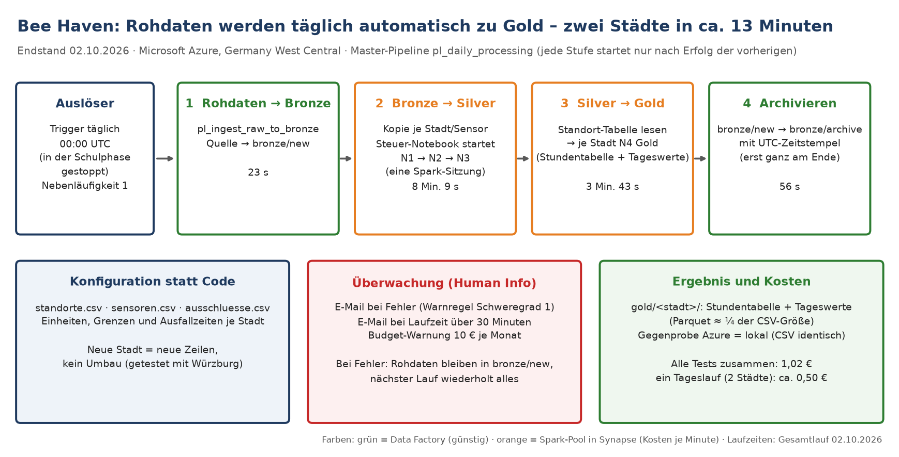
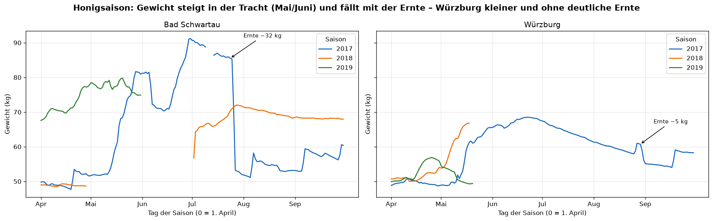
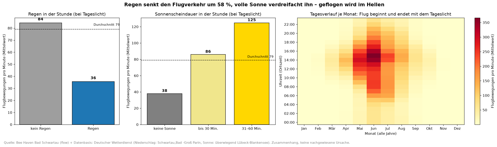
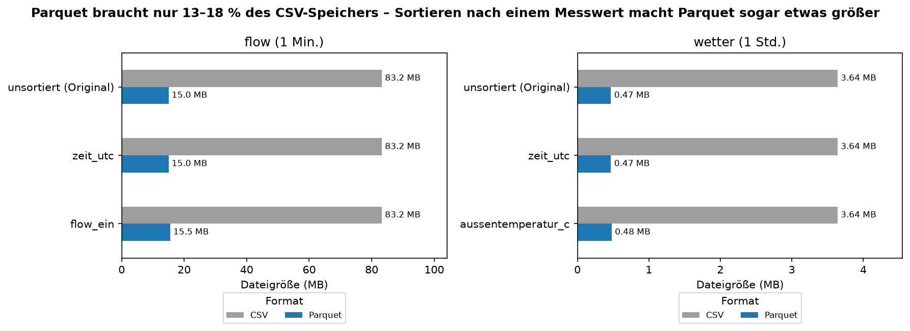

# Azure – Automatisierte Datenpipeline mit Medallion-Architektur



Ein Unternehmen erhält täglich Rohdaten-Dateien (Sensoren, Exporte aus anderen Systemen) und braucht sie **archiviert, geprüft, angereichert und auswertbar – ohne Handarbeit**. Dieses Projekt baut dafür eine vollständig automatisierte Datenplattform in **Microsoft Azure** nach der **Medallion-Architektur** auf und testet sie mit einem realen Datensatz: Sensordaten von Bienenstöcken (Bee Haven, zwei Standorte, 2017–2019).

📊 [Präsentation (PDF)](05_dokumentation/PS-ITS-001_Praesentation_Geschaeftsleitung_v1.1.pdf) · [PowerPoint](05_dokumentation/PS-ITS-001_Praesentation_Geschaeftsleitung_v1.1.pptx) · 📄 [Pflichtenheft](01_projektmanagement/PH-ITS-002_Pflichtenheft_Azure-Datenplattform_v1.10.docx) · 🗂️ [Projektplan](01_projektmanagement/PP-ITS-002_Projektplan_Azure-Datenplattform_v1.11.docx) · 📘 [Schritt-für-Schritt-Anleitung (PDF, 91 Seiten)](05_dokumentation/AN-ITS-001_Anleitung_Azure-Datenplattform_v3.0.pdf)

Entstanden im Rahmen der Weiterbildung „Data Science & AI“ der WBS Coding School (Cloud Computing mit Azure, Prüfungsthema DP-900).

## Projektübersicht

- **Problem:** Rohdaten kommen unregelmäßig, in unterschiedlichen Einheiten und mit Fehlern; manuelle Aufbereitung ist langsam, fehleranfällig und nicht nachvollziehbar.
- **Lösung:** Eine Master-Pipeline (`pl_daily_processing`) in **Azure Data Factory** steuert vier Stufen – Rohdaten → **Bronze** (unverändert archiviert) → **Silver** (bereinigt, geprüft, mit Wetter angereichert) → **Gold** (Kennzahlen je Stunde und Tag). Die Verarbeitung läuft in Notebooks auf einem **Azure Synapse Spark-Pool**.
- **Ergebnis:** Täglicher Zeitplan (00:00 UTC), E-Mail-Warnung bei Fehlern oder zu langer Laufzeit, Gegenprobe Azure = lokale Berechnung. **Ein zweiter Standort kam ohne eine Zeile neuen Code hinzu** – nur über neue Zeilen in drei Konfigurationstabellen.

## Praxisnutzen im Unternehmen

Das Muster ist unabhängig vom Datensatz und lässt sich direkt auf betriebliche Datenquellen übertragen (z. B. ERP-Exporte, Finanzdaten, Maschinen- oder IoT-Sensoren):

- **Konfiguration statt Code:** Neue Standorte, Einheiten, Grenzwerte und bekannte Ausfälle stehen in Tabellen (`lakehouse/konfiguration/`) – Fachbereiche können Regeln ändern, ohne die Pipeline umzubauen.
- **Markieren statt löschen:** Ungültige Werte werden gekennzeichnet, nie entfernt – jede Entscheidung bleibt prüfbar (Revisionssicherheit).
- **Rohdaten unverändert archiviert:** Jede Auswertung lässt sich aus Bronze neu rechnen.
- **Betrieb abgesichert:** Zeitplan, Warnregeln, Budget mit Warnstufen, verwaltete Identitäten mit geringsten Rechten (Least Privilege), Abläufe mit Rollen und Prüfschritten als BPMN-Prozesse dokumentiert.
- **Kosten transparent:** alle Tests zusammen **1,02 €**; Hochrechnung Dauerbetrieb ca. 0,50 € je Tageslauf (≈ 15 € im Monat) – mit inkrementeller Verarbeitung deutlich weniger.

## Datensatz & Quellen

- **Sensordaten:** Kaggle „Beehive Metrics“, Ursprung HOBOS (Universität Würzburg) – je Standort 4 Dateien (Gewicht, Flugbewegungen, Temperatur, Luftfeuchte); Lizenz unbekannt → **Rohdaten werden nicht veröffentlicht** (per `.gitignore` ausgeschlossen)
- **Standorte:** Bad Schwartau (Gewicht in g, alle 12 h) und Würzburg (Gewicht in kg, jede Minute; Station Mai–Okt. 2018 ausgefallen)
- **Wetter je Stunde:** Deutscher Wetterdienst über die **Bright Sky REST-API** – ein Abruf je Lauf, Rohantwort in Bronze archiviert, Quellstation je Wert geprüft; 21.145 Stundenwerte (Schwartau), 20.881 (Würzburg)
- **Sonnenstand** berechnet (NOAA-Formeln) → Tag / Dämmerung / Nacht statt fester Uhrzeiten
- **Zeitzone:** Zeitstempel in deutscher Ortszeit → in UTC umgerechnet (keine Duplikate bei der Zeitumstellung)

## Wichtige Erkenntnisse & Ergebnisse

- **Vollautomatisch und günstig:** Gesamtlauf beider Standorte ≈ 13 Minuten; die Bereinigung (Bronze → Silver) braucht fast zwei Drittel davon, weil jeder Lauf alle 2,5 Jahre neu rechnet → größter Hebel: nur neue Tage verarbeiten.
- **Der Honigertrag unterscheidet sich je Standort stark:** Saison 2017 (Untergrenze) Bad Schwartau ≈ **74 kg**, Würzburg ≈ **24 kg**.

  
- **Sonne und trockenes Wetter bestimmen den Bienenflug stärker als die Temperatur:** Regen −58 % (Schwartau) / −69 % (Würzburg); volle Sonne 3–5× so viele Flüge wie eine bedeckte Stunde.

  
- **Gute Honigtage sind selten und sonnig:** 19 % von 290 Saisontagen sind ertragsstark (+1,1 kg): 8,9 statt 5,8 Sonnenstunden, ≈ 105.000 Einflüge, ≈ 6 mg Honig je Einflug.
- **Weitere Erkenntnisse aus den Notebooks:** 90 % der Flüge bei Tageslicht · kein Flug unter 5 °C, Maximum bei 20–30 °C · je trockener die Luft, desto mehr Flüge · Strahlung steigert den Flug auf jeder Temperaturstufe · Wind und Luftdruck ohne Einfluss unter gleichen Bedingungen
- **Handlungsempfehlungen (Auszug):** Plattform als Standard für weitere Datenquellen nutzen (Pilot) · nur neue Daten verarbeiten · Eingang absichern (Dateinamen, Duplikate) · ereignisbasiert starten · Gold als Sternschema für Power BI · Rechte nach Rollen und Versionsverwaltung mit Git – Details in Präsentation und Projektplan

## Zusatz- und Bonusaufgaben

- **Speicherformate (Bonus):** Parquet braucht nur 13–18 % der CSV-Größe (Flug 83,2 → 15,0 MB, Wetter 3,6 → 0,47 MB); Sortieren nach Wert bringt nichts → Silver/Gold als zeitlich sortiertes Parquet

  
- **Zweiter Standort** nur über Konfiguration · **Standortvergleich** Honigertrag (Notebook 06)
- **Prozesse (BPMN):** [Übersicht](07_prozesse_QM/BPMN-ITS-002-2026_einrichtung-uebersicht.png) · Phasen [1](07_prozesse_QM/BPMN-ITS-003-2026_phase1-azure.png) [2](07_prozesse_QM/BPMN-ITS-004-2026_phase2-notebooks.png) [3](07_prozesse_QM/BPMN-ITS-005-2026_phase3-automatisierung.png) · [täglicher Lauf](07_prozesse_QM/BPMN-ITS-001-2026_taeglicher-lauf.png)

## Grafik-Galerie

Jede Auswertung gibt es für beide Standorte (dasselbe Notebook, Parameter `STADT`).

| Grafik | Bad Schwartau | Würzburg |
| :-- | :-- | :-- |
| Gewichtsverlauf, Ernte, Ausfall | [f1](04_images/schwartau/f1_gewicht_verlauf.png) | [f1](04_images/wurzburg/f1_gewicht_verlauf.png) |
| Flugsaison Mai–August | [f2](04_images/schwartau/f2_flugaktivitaet_monat.png) | [f2](04_images/wurzburg/f2_flugaktivitaet_monat.png) |
| Temperatur und Einflüge | [f3](04_images/schwartau/f3_temperatur_einflug.png) | [f3](04_images/wurzburg/f3_temperatur_einflug.png) |
| Temperatur-Markierungen meist Rauschen | [d2](04_images/schwartau/d2_sensitivitaet_temperatur.png) | [d2](04_images/wurzburg/d2_sensitivitaet_temperatur.png) |
| Wetter und Sonnenstand | [n3](04_images/schwartau/n3_wetter_sonne.png) | [n3](04_images/wurzburg/n3_wetter_sonne.png) |
| 90 % der Flüge bei Tageslicht | [a2](04_images/schwartau/a2_flug_tageszeit.png) | [a2](04_images/wurzburg/a2_flug_tageszeit.png) |
| Maximum bei 20–30 °C | [a3/a5](04_images/schwartau/a3_a5_flug_temperatur.png) | [a3/a5](04_images/wurzburg/a3_a5_flug_temperatur.png) |
| Regen, Sonne und Tageszeit | [a4/a6](04_images/schwartau/a4_a6_flug_regen_sonne_stunde.png) | [a4/a6](04_images/wurzburg/a4_a6_flug_regen_sonne_stunde.png) |
| Trockene Luft = mehr Flüge | [a7](04_images/schwartau/a7_flug_feuchte.png) | [a7](04_images/wurzburg/a7_flug_feuchte.png) |
| Strahlung steigert den Flug | [a8](04_images/schwartau/a8_flug_strahlung_hitze.png) | [a8](04_images/wurzburg/a8_flug_strahlung_hitze.png) |
| Wind und Luftdruck ohne Einfluss | [a9/a10](04_images/schwartau/a9_a10_flug_wind_luftdruck.png) | [a9/a10](04_images/wurzburg/a9_a10_flug_wind_luftdruck.png) |
| Honigtage sind sonnig und trocken | [h1](04_images/schwartau/h1_honig_produktion.png) | [h1](04_images/wurzburg/h1_honig_produktion.png) |

Projektgrafiken: [Pipeline Endstand](04_images/p2_pipeline_endstand.png) · [Pipeline Soll/Ist](04_images/p1_pipeline_ist_soll.png) · [Projektüberblick](04_images/gesamtgrafik_beehaven.png) · [Honigsaison je Standort](04_images/v1_honig_saison.png) · [CSV vs. Parquet](04_images/z1_speicherformate.png)

## Verwendete Technologien

- **Cloud:** Azure Data Lake Storage Gen2, Azure Data Factory (Pipelines, ForEach/Lookup, Zeitplan-Trigger), Azure Synapse Analytics (Spark-Pool, Notebook-Aktivitäten, `mssparkutils.notebook.runMultiple`), Azure Monitor (Warnregeln), Cost Management (Budget), verwaltete Identitäten mit rollenbasierter Zugriffssteuerung (RBAC), REST-API (Bright Sky)
- **Programmierung:** Python (pandas, pyarrow, numpy, matplotlib, requests), Parquet
- **Umgebung:** VS Code + Jupyter, Conda
- **Dokumentation:** Pflichtenheft, Projektplan, Anleitung (Word/PDF), Prozesse als BPMN 2.0

## Projektstruktur

```
01_projektmanagement/        # Brainstorming, Projektplan, Pflichtenheft (Word)
02_daten_ITS-Data/lakehouse/ # lokaler Spiegel des Azure-Containers (Daten nicht veröffentlicht)
  konfiguration/             #   Standorte, Sensorregeln, bekannte Ausfälle (versioniert)
03_notebooks_ITS-Data/       # 00 Steuerung · N1 Bereinigung · N2 Qualität · N3 Wetter · N4 Gold · N5 Analyse · 06 Standortvergleich · Z1 Speicherformate
  synapse/                   #   Fassungen für Azure Synapse (erzeugt)
  wurzburg/                  #   Fassungen für Würzburg (erzeugt mit stadt_fassungen.py)
04_images/                   # Übersichtsgrafiken; je Standort in schwartau/ und wurzburg/
05_dokumentation/            # Schritt-für-Schritt-Anleitung (91 Seiten), Präsentation (PDF, PowerPoint)
07_prozesse_QM/              # Prozesse als BPMN 2.0 (Übersicht, Phasen, täglicher Lauf) – Datei für bpmn.io und Bild
requirements.txt             # Python-Abhängigkeiten
```

## Wie man dieses Projekt nutzt

1. **Überblick:** zuerst die [Präsentation](05_dokumentation/PS-ITS-001_Praesentation_Geschaeftsleitung_v1.1.pdf), dann das [Pflichtenheft](01_projektmanagement/PH-ITS-002_Pflichtenheft_Azure-Datenplattform_v1.10.docx) (Kapitel 0 und 7)
2. **Umgebung:** `conda create -n beehaven python=3.12` und `pip install -r requirements.txt`
3. **Lokal ausführen:** Rohdateien `<sensor>_<standort>.csv` in `02_daten_ITS-Data/lakehouse/silver/processing/<standort>/<sensor>/` legen, Notebooks `01` → `05` in `03_notebooks_ITS-Data/` ausführen (Standort = Parameter `STADT`); weiterer Standort: `python stadt_fassungen.py <standort>`
4. **Azure nachbauen:** der [Anleitung](05_dokumentation/AN-ITS-001_Anleitung_Azure-Datenplattform_v3.0.pdf) folgen (Ressourcen, Rechte, Pipelines, Synapse, Trigger)

## Zukünftige Arbeiten

- **Betrieb:** nur neue Tage verarbeiten (inkrementell), Eingangsprüfung (Dateinamen, Doppellieferungen), ereignisbasierter Start, Git-Anbindung von Data Factory und Synapse
- **Dashboard** mit Warnungen (Temperaturabfall im Stock, ungewöhnlicher Gewichtsverlust) und Gold als Sternschema für Power BI; Warnregeln fachlich mit einer Imkerei bestätigen
- **Machine Learning:** Einzelwirkungen von Sonne, Regen, Luftfeuchte und Jahreszeit trennen; Honigertrag prognostizieren

## 📧 Kontakt

Siehe mein [GitHub-Profil](https://github.com/Mathias-Stumpf2026).

## Datenquellen & Nachweise

- Bienenstock-Daten: Kaggle „Beehive Metrics“ (HOBOS, Universität Würzburg) – Lizenz unbekannt, nicht weitergegeben
- Wetterdaten: Datenbasis: Deutscher Wetterdienst (DWD Open Data), abgerufen über [Bright Sky](https://brightsky.dev/)
- Sonnenauf-/-untergang zur Gegenprobe: [Open-Meteo](https://open-meteo.com/) (CC BY 4.0)
- Sonnenstandsformeln: NOAA General Solar Position Calculations

---

## English Summary

This project builds a **fully automated data pipeline on Microsoft Azure following the Medallion architecture** (raw → Bronze → Silver → Gold). A master pipeline in **Azure Data Factory** orchestrates notebooks on an **Azure Synapse Spark pool**: raw files are archived unchanged, cleaned and validated, enriched with hourly weather data from the German Weather Service (Bright Sky REST API), and aggregated into hourly and daily KPIs. The platform runs on a daily schedule with e-mail alerts and was tested with real beehive sensor data (Bee Haven, two sites, 2017–2019).

**Key results:**
- Full run for two sites in about 13 minutes; all Azure tests together cost **€1.02** (estimated €15/month in continuous operation); Azure output identical to the local run.
- **A second site was added without changing any code** – only new rows in three configuration tables (configuration over code, invalid values flagged instead of deleted).
- Findings: honey yield 2017 differs by site (≈ 74 kg vs. 24 kg); sun and dry weather drive flight activity more than temperature (rain −58 % / −69 %); Parquet needs only 13–18 % of the CSV size.

The pattern transfers directly to business data sources such as ERP exports, finance data or IoT sensors. Full documentation (German): [presentation](05_dokumentation/PS-ITS-001_Praesentation_Geschaeftsleitung_v1.1.pdf), [requirements & results](01_projektmanagement/PH-ITS-002_Pflichtenheft_Azure-Datenplattform_v1.10.docx), [step-by-step guide](05_dokumentation/AN-ITS-001_Anleitung_Azure-Datenplattform_v3.0.pdf).
